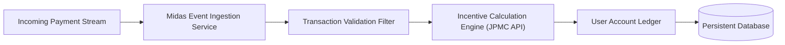

# JPMorgan Chase & Co. — Advanced Software Engineering (Midas Microservice)

<p align="center">
  
  
  
  
  
</p>

## 📌 Project Overview

This repository contains the implementation of the **Midas Transaction Processing Microservice** completed as part of the **JPMorgan Chase & Co. Advanced Software Engineering Virtual Experience Program** on Forage. 

The project focuses on backend financial systems engineering: consuming asynchronous financial transaction streams, applying business validation rules, calculating transaction incentives, and persisting transaction records with deterministic precision.

---

## 🎯 Program Modules & Key Engineering Tasks

1. **Transaction Event Processing:** Implementing Kafka consumer / stream handlers to ingest high-frequency user transaction events.
2. **Transaction Incentive Service:** Developing an incentive computation engine that evaluates transaction amounts, user tiers, and reward eligibility.
3. **Data Integrity & Persistence:** Mapping database schemas with Spring Data JPA and managing ACID transaction guarantees across balances.
4. **Resilience & Testing:** Writing unit and integration test fixtures verifying financial boundary calculations and edge-case handling.

---

## 🏗️ Architecture & Component Workflow



---

## 🛠️ Verified Technology Stack

| Component | Technology | Purpose |
|---|---|---|
| **Language** | Java 17 | Core enterprise runtime |
| **Framework** | Spring Boot | Dependency injection, REST API, microservice configuration |
| **Service Integration** | Transaction Incentive API (`.jar`) | Proprietary transaction incentive validation service |
| **Build Tool** | Apache Maven (`mvnw`) | Standardized Maven wrapper build and lifecycle execution |
| **Configuration** | `application.yml` | Environment-specific connection and service properties |

---

## 📁 Repository Structure

```
forage-midas/
├── services/                 # External service JARs and mock APIs
│   └── transaction-incentive-api.jar
├── src/
│   ├── main/java/            # Microservice business logic, models, and controllers
│   └── test/java/            # Unit and regression test suites
├── application.yml           # Spring Boot application configuration
├── pom.xml                   # Maven dependencies and plugin declarations
├── mvnw / mvnw.cmd           # Cross-platform Maven wrappers
└── README.md                 # Project documentation
```

---

## 🚀 Running the Service

### Prerequisites
- **JDK 17** installed and configured on your `PATH`.

### Build & Run
```bash
# Clone the repository
git clone https://github.com/purvgandhi/forage-midas.git
cd forage-midas

# Build the microservice
./mvnw clean package

# Run the Spring Boot application
./mvnw spring-boot:run
```

---

## 👨‍💻 Participant & Attributions
- **Completed By:** [Purv Gandhi](https://github.com/purvgandhi) (S.Y. B.Tech IT, DJSCE Mumbai)
- **Program Host:** [JPMorgan Chase & Co.](https://www.jpmorganchase.com/) via [Forage](https://www.theforage.com/)
- **LinkedIn:** [linkedin.com/in/purv-gandhi-17989330a](https://www.linkedin.com/in/purv-gandhi-17989330a/)
